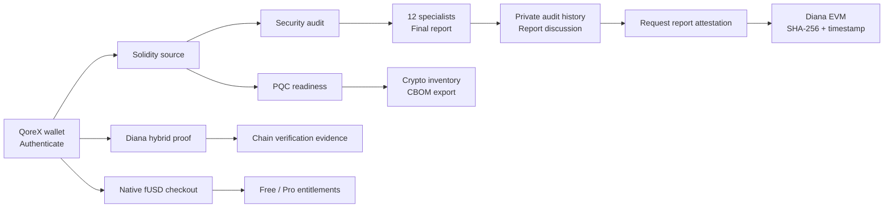
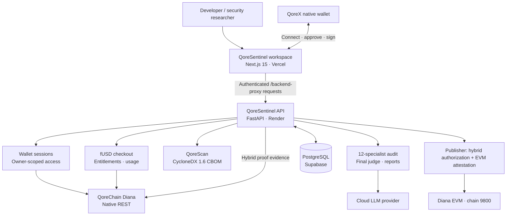

# QoreSentinel

**Smart-contract auditing meets post-quantum readiness.**

Every smart contract raises two security questions: *What can go wrong in its logic?* And *which cryptographic systems does it depend on?* QoreSentinel brings both answers into one wallet-connected workspace on QoreChain.

With **12 specialist security agents and a final judge**, QoreSentinel analyzes Solidity contracts and delivers detailed findings with source evidence. Alongside the audit, **QoreScan-powered PQC Readiness** identifies cryptographic dependencies, highlights quantum-vulnerable algorithms, and generates a CycloneDX 1.6 Cryptographic Bill of Materials (CBOM). **QoreX and QoreChain Diana** complete the experience with wallet-based access, hybrid-signature transaction evidence, automated on-chain audit-report attestations, and testnet fUSD subscriptions.

From source submission to security reporting, cryptographic inventory, and on-chain verification, QoreSentinel gives builders a connected view of their contracts.

**Application:** https://qoresentinel.vercel.app  
**Network:** QoreChain Diana testnet (`qorechain-diana`, EVM chain ID `9800`)

## What QoreSentinel delivers

| Workspace capability | What happens | What the user receives |
| --- | --- | --- |
| **Smart-contract audit** | Twelve specialist security agents examine Solidity source and a final judge consolidates the findings. | Job progress, a Markdown security report, agent output, and report-derived finding summaries. |
| **PQC Readiness** | QoreScan inventories cryptographic references from a saved project, pasted Solidity, or uploaded source files/ZIP. | Algorithm classifications, source-line evidence, a CycloneDX 1.6 CBOM, and a readiness report. |
| **Hybrid-signature proof** | QoreX authorizes a small Diana-native self-transfer; QoreSentinel inspects the chain response for the hybrid-signature extension and successful verification event. | A transaction hash and chain-reported hybrid-verification evidence. |
| **Audit history** | Completed reports, running jobs, and per-audit discussions are retained against the authenticated wallet. | Private audit URLs and the ability to reopen a report without running it again. |
| **On-chain report attestation** | An authenticated user requests publication of their completed audit's SHA-256 through the dedicated hybrid-authorized publisher. | A Diana testnet attestation timestamp and contract transaction hash, without publishing report contents. |
| **Billing and usage** | The API applies wallet-scoped Free and Pro limits. Native fUSD payments become subscriptions only after the transaction is verified on-chain. | Current plan, remaining audit allowance, pending checkout state, and verified transaction activity. |

## The experience

A project can follow the full audit journey or be scanned independently for post-quantum readiness. Wallet identity connects the saved reports, transaction evidence, and subscription experience.

### Audit a smart contract

A QoreX wallet establishes the workspace identity. A Solidity project is created from pasted source, individual `.sol` files, or a ZIP containing Solidity contracts. The submitted files become part of that wallet's saved project.

Starting an audit creates a persistent job ID. The API reserves one of the wallet's available audit slots, queues execution, and reports progress as the twelve specialist analyses complete. The final synthesis is saved as Markdown alongside the individual agent results. The results page presents report-derived findings and their evidence alongside the complete security analysis.

A report remains accessible through its private `/audits/{audit-id}` URL. The same wallet can reopen saved reports and discussion threads at any time. Server-side ownership checks keep audit history and report access private to the authenticated wallet.

### Anchor an audit report on QoreChain

The audit-results page lets users request a free-on-testnet, publisher-signed
on-chain attestation of their **completed, wallet-owned audit**. A dedicated
Render backend publisher uses an ML-DSA-87 hybrid-signed native authorization
window restricted to the deployed `QoreSentinelAttestation` contract, then
publishes only the report's SHA-256 digest. The UI displays request progress,
transaction hash and the chain-verified timestamp once confirmed.

The publisher contract, `0x457962c68d6F3BeaAdAF47456402F57Fb40Fc6BF`, is
deployed on Diana testnet (EVM chain ID 9800). Automatic publishing is enabled
only when configured with the dedicated publisher credentials. The report
contents remain wallet-protected in the backend, and on-chain publication
is evidence of timestamped report bytes—not proof that AI findings are true.
The implementation applies a three-distinct-attestation daily wallet limit,
idempotent requests and bounded fees.

#### Verified live attestation (28 November 2026)

The **wallet-authenticated web interface** successfully requested publication of a completed audit. QoreSentinel's backend publisher submitted the report digest and the application subsequently displayed **`confirmed`** and **`Verified on Diana`**, with an on-chain publication timestamp.

| Evidence | Value |
| --- | --- |
| Network | QoreChain Diana testnet, EVM chain ID `9800` |
| Attestation contract | [`0x457962c68d6F3BeaAdAF47456402F57Fb40Fc6BF`](https://explore.qore.network/) (select Testnet and search the address) |
| Contract publisher (EVM) | `0x28ae5289681319a1b0c05b3ffbbb658d15ad33e9` |
| Sample audit report SHA-256 | `0x5dad307f63853af2af9590c2ac3656895e1e64385603c60937264d11d653039f` |
| Confirmed UI-requested attestation tx | `0x4ba2f6d45ce7afe5a0eef16c34f820d4528a29149890633860e38e79e9f2a958` |
| On-chain publication (UTC) | **2026-11-28 09:06:22** |
| Deployment-era hybrid EVM-window native tx | `B8F95A264E7B9CAA9F4B2D8CE60ECBEDAB238AF6315580CB93813FE0DCC17B42` — independently checked for the `PQCHybridSignature` extension and `pqc_hybrid_verify=verified` |

The deployment-era hybrid-window transaction is **not** presented as the native-window transaction for the UI-requested attestation; that separate hash was not captured in this documentation. Hashes above are public testnet evidence, not report contents. The SHA-256 attests exact saved report bytes and publication time, **not** the correctness of the security findings. The screenshots/logs from the successful end-to-end run were recorded on 28 November 2026.

**Try it:** Connect QoreX on Diana, run or reopen a completed audit, select **Request on-chain attestation**, and watch the results panel progress from `queued` / `processing` / `submitted` to `confirmed`. The page then shows **Verified on Diana**, the published timestamp and the transaction hash. Reports are wallet-owned; the publisher pays testnet gas rather than asking the user to expose signing keys. See the [backend](backend/README.md#automated-report-attestations-diana-only) and [on-chain module](onchain/README.md) for implementation and recovery details.

### Map post-quantum exposure

PQC Readiness is a separate workflow. It accepts a previously saved project, newly pasted Solidity, or uploaded Solidity files/ZIPs. QoreScan examines the source and inventories algorithms such as ECDSA, Keccak-256, and SHA-256, including the file and line associated with each detection.

The output includes a **CycloneDX 1.6 CBOM**, QoreScan classification and transition metadata, and a downloadable framework-mapped Markdown report when available. The dashboard distinguishes quantum-vulnerable public-key cryptography from hashes and other cryptographic primitives.

**Unlimited, on-demand PQC analysis is independent of paid auditing.** Saved projects can be rescanned, while pasted and uploaded sources run as temporary, history-free scans. Each run produces downloadable CBOM and readiness-report outputs for further analysis and sharing.

### Verify hybrid-signature activity

QoreSentinel uses QoreX's native `qor1` wallet interface on Diana. Native authentication begins with a short-lived challenge and a wallet-approved 1 uqor self-transfer containing the challenge memo. The backend checks the sender, recipient, amount, memo, confirmation, and chain-reported hybrid verification before issuing a one-hour session.

The separate hybrid-proof action uses another wallet-approved 1 uqor self-transfer and inspects the transaction record for the PQC hybrid extension and verification event. The dashboard presents the resulting **QoreChain-reported hybrid-signature evidence**, linked to the transaction hash.

An authenticated browser session can be restored after refresh through a secure, HTTP-only cookie. Locked-wallet and network-mismatch states are surfaced in the interface; compatible QoreX versions may display their own unlock prompt when wallet access is requested.

### Access Free and Pro plans

The billing screen retrieves the server-defined testnet fUSD amount and treasury destination before requesting a QoreX-approved transfer. The resulting transaction hash is associated with a pending payment intent, enabling seamless checkout recovery after a page refresh.

On-chain settlement verification matches the sender, treasury, denomination, exact amount, memo, hybrid-signature verification, and confirmation depth. Once verified, the payment activates 30 days of Pro access on the Diana testnet.

## Architecture

QoreSentinel connects an intuitive security workspace to server-enforced analysis, wallet identity, and QoreChain transaction verification.

The Next.js frontend manages navigation, contract submission, wallet interaction, and report exports. FastAPI handles session verification, project access, usage enforcement, audits, cryptographic inventory, and settlement checks. Project records, audit reports, discussions, and subscriptions are stored in PostgreSQL.

| Repository area | Role |
| --- | --- |
| [`frontend/`](frontend/README.md) | Workspace routes, QoreX interaction, QoreScan presentation, audit progress and billing UI. |
| [`backend/`](backend/README.md) | API, persistent state, twelve-specialist audit orchestration, QoreScan execution, QoreChain evidence and payment verification. |
| `backend/audit/` | Specialist-agent orchestration, report synthesis, prompts and cloud-provider adapters. |
| `backend/tests/` | Authentication, billing, job history, direct API authorization, PQC, wallet session, scanner and attestation regression tests. |
| [`onchain/`](onchain/README.md) | Deployed Solidity attestation contract, Hardhat tests, hybrid-window scripts, deployment instructions and on-chain evidence. |

## Security and access

QoreSentinel keeps contract security workflows tied to a verified wallet identity. Its API performs source validation, project ownership checks, audit quota reservation, report authorization, and on-chain payment verification before committing protected operations.

**Free and Pro audit allowances are enforced server-side:** the default rolling 24-hour limits are two audits for Free and ten for Pro, with separate security-assistant allowances. PQC inventory scanning remains available to authenticated users independently of paid audit usage.

Saved audit history, detailed results, report conversations, subscription activity, and transaction history are organized by wallet. QoreX handles native transaction approvals, and FastAPI validates the corresponding QoreChain Diana evidence.

## Acknowledgements

We acknowledge Pashov Audit Group for the MIT-licensed `solidity-auditor` skill, including the twelve specialist-agent prompts and supporting audit methodology used in QoreSentinel's security-analysis workflow.

QoreSentinel integrates these materials into a Python-based application architecture covering Solidity source ingestion, audit orchestration, cloud LLM providers, report generation, wallet authentication and QoreChain integrations.

The upstream Pashov skills are MIT-licensed. Relevant upstream copyright and licence notices are preserved in accordance with the licence.

QoreSentinel is an independent project and is not affiliated with or endorsed by Pashov Audit Group.

**Upstream project:** [https://github.com/pashov/skills](https://github.com/pashov/skills)

**Upstream copyright and licence notices:** [THIRD_PARTY_NOTICES.md](THIRD_PARTY_NOTICES.md)

**AI usage and development disclosure:** [AI_USAGE.md](AI_USAGE.md)

## Contact

**Therock Ani** — Creator & Lead Developer

- GitHub: https://github.com/rocknwa
- Portfolio: https://therock-ani.vercel.app
- LinkedIn: https://www.linkedin.com/in/therock-ani-13336224b/
- X: https://x.com/ani_therock
- Telegram: https://t.me/Tech_Scorpion
- Email: anitherock44@gmail.com

## License

QoreSentinel is released under the [MIT License](LICENSE).
