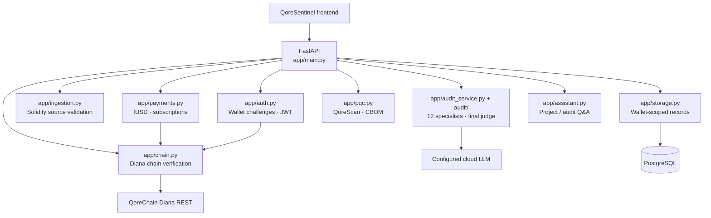
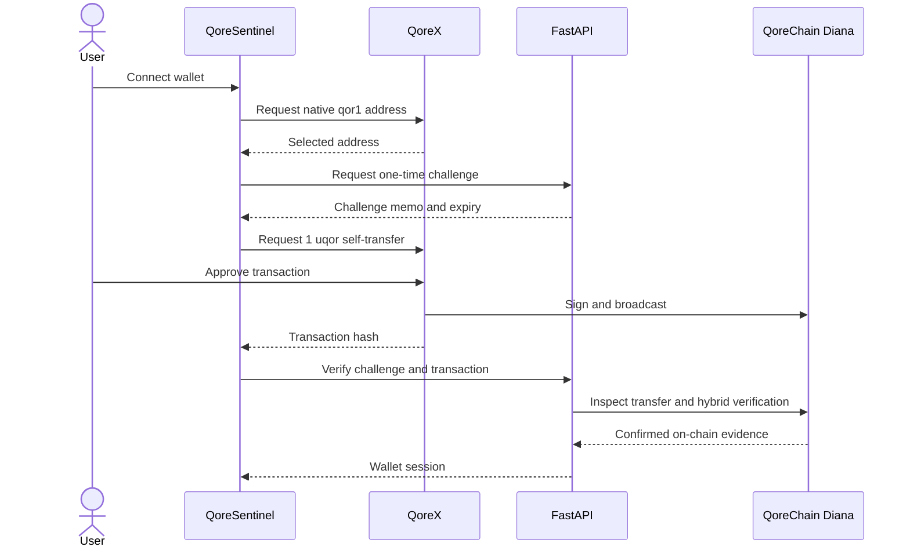

# QoreSentinel API

**From contract source to security intelligence, cryptographic visibility, and verified QoreChain activity.**

The QoreSentinel API connects the 12-specialist audit workflow, QoreScan cryptographic inventory, wallet authentication, saved reports, and Diana testnet payments. A single FastAPI service processes Solidity submissions, coordinates analyses, maintains wallet-specific records, and verifies the network events that underpin wallet access and subscriptions.

The hosted application uses **FastAPI + SQLAlchemy + PostgreSQL** (Supabase), with the service deployed on Render. SQLite remains the local/test storage backend. The audit orchestration and QoreScan executable run server-side; cloud provider credentials and billing configuration never belong in the browser.

## Request and data flow

Wallet authentication, source ingestion, audit orchestration, scanner execution, and native payment settlement are connected through the FastAPI service. Persistent project, audit, and subscription records are managed through SQLAlchemy.

### Wallet identity and sessions

For the native `qor1` path, the backend generates a five-minute, single-use challenge tied to the wallet address. QoreX signs and broadcasts a 1 uqor self-transfer with the exact challenge memo. The API validates the message, sender, recipient, amount, chain-reported hybrid verification and transaction confirmation before consuming the challenge.

A successful verification issues a one-hour JWT session, delivered as a Bearer token and an HTTP-only, SameSite=Lax cookie (Secure by default). The same session governs project ownership, audit history, report discussions, usage and payment records. A legacy EVM message-signature challenge is also present in the API, although the primary product flow uses QoreX native authentication.

**Authorization is enforced by the API:** project IDs, audit IDs, report URLs, discussions, and billing records are resolved against the authenticated wallet. This protection also applies to direct API requests.

### Source ingestion and saved projects

Project ingestion accepts pasted Solidity, individual `.sol` files or a ZIP containing Solidity source. Archive paths and file types are validated before any data is stored. Binary files, traversal paths, symlinks and oversized uploads are rejected. Non-Solidity ZIP members are ignored.

Solidity ingestion applies a controlled source-text processing pipeline with file and archive validation. It supports up to 80 source files, checks expanded archive sizes, and processes Solidity references without running uploaded scripts or project commands.

Saved project source is associated with the authenticated wallet in the `projects` table. Temporary source submitted through the standalone PQC endpoints is not created as a project.

### 12-specialist security analysis

Audit creation requires a saved project with Solidity source, the configured Python audit pipeline and at least one configured cloud LLM provider. The reservation is performed server-side before a worker is scheduled. PostgreSQL advisory transaction locks protect each wallet's quota and pending-job reservation against concurrent requests.

The job begins at `queued`, moves to `running` and finishes as `completed` or `failed`. The Python audit modules in `audit/` coordinate twelve specialist analyses, track completed-agent counts, and pass the results to the final judge. The persisted output comprises the Markdown report and raw per-agent results. `app/findings.py` extracts report-derived finding summaries and associates them with their evidence status for the user interface.

Audit IDs persist independently of the browser. The report endpoint, job history and per-audit assistant conversations are all constrained to the wallet that owns the job.

Audit execution is coordinated by a dedicated `ThreadPoolExecutor`. Job state, agent progress, completed reports, and related conversations are recorded in PostgreSQL, allowing the workspace to retrieve them by audit ID.

### QoreScan and cryptographic readiness

`app/pqc.py` invokes QoreScan Community 0.1.0 against a temporary source directory. Its official output is a CycloneDX 1.6 CBOM of cryptographic assets, classifications, file/line occurrences, transition metadata and dependencies. QoreSentinel also exposes QoreScan's framework-mapped Markdown report when the CLI produces one.

Three authenticated routes serve the same stateless inventory:

| Source | API endpoint | Storage behavior |
| --- | --- | --- |
| Existing saved project | `POST /api/v1/projects/{project_id}/pqc/scan` | Reuses wallet-owned source; does not create a new report or history entry. |
| Pasted Solidity | `POST /api/v1/pqc/scan` | Scans request source; does not create or change a project. |
| `.sol` files or ZIP | `POST /api/v1/pqc/scan/files` | Validates and scans the upload without storing a project or scan history. |

**PQC analysis is stateless and independent of audit entitlements.** Authenticated users can scan saved or newly submitted source, receive the cryptographic inventory immediately, export the results, and rerun the analysis as needed. The endpoints maintain a distinct, history-free flow from the twelve-specialist audit.

The standard QoreScan invocation analyzes Solidity source. The `QORE_QORESCAN_NETWORK=testnet` configuration extends the scan with read-only Diana network context. Both modes return structured algorithm evidence, classifications, and transition metadata.

### QoreChain evidence and fUSD entitlements

`app/chain.py` reads the Diana native REST API to check balances, native transactions and hybrid-signature evidence. The recorded verification is derived from successful transaction status, the `PQCHybridSignature` extension and a `pqc_hybrid_verify` event. Transaction hashes, hybrid extensions, and verification events are captured as evidence from the network.

The Pro checkout is a QoreX-approved **native fUSD bank transfer on Diana**. The backend creates a time-limited payment intent with its own memo, expected denomination, exact raw amount and treasury recipient. A recorded broadcast hash supports checkout recovery while chain settlement is verified.

An entitlement is credited only after the server verifies a matching sender, recipient, amount, memo, required hybrid verification and confirmation depth, then marks the intent paid and records the transaction. Verified Pro access lasts 30 days, with renewal extending the existing expiry. QoreSentinel records the verified native fUSD payment as a Diana testnet transaction.

### Audit and assistant usage policy

| Capability | Free | Pro |
| --- | --- | --- |
| Audits | 2 per rolling 24 hours by default | 10 per rolling 24 hours by default |
| Assistant requests | 10 per rolling 24 hours by default | 50 per rolling 24 hours by default |
| PQC inventory | Unmetered by plan; authenticated | Unmetered by plan; authenticated |
| Saved audit reports | Wallet-owner access | Wallet-owner access |

**Usage is enforced centrally by FastAPI.** PostgreSQL-backed reservations account for concurrent requests, while wallet-scoped entitlements and rolling-window usage statistics are available to the workspace through the subscription API.

## API surface

All paths are relative to the FastAPI service; protected endpoints require the wallet session.

| Area | Principal routes | Result |
| --- | --- | --- |
| Health | `GET /health` | Service status. |
| Native authentication | `POST /api/v1/auth/native/challenge`, `POST /api/v1/auth/native/verify` | One-time challenge and verified wallet session. |
| Session | `GET /api/v1/auth/session`, `POST /api/v1/auth/logout` | Session restoration and cookie invalidation. |
| Projects | `GET/POST /api/v1/projects`, `GET /api/v1/projects/{id}` | Wallet-owned project index and metadata. |
| Source | `POST /api/v1/projects/{id}/source`, `POST /api/v1/projects/{id}/files` | Validated Solidity stored against a project. |
| Audits | `POST /api/v1/projects/{id}/audits`, `GET /api/v1/audits/{id}`, `GET /api/v1/audits` | Job submission, status/report retrieval and history. |
| Audit discussion | `GET/POST /api/v1/audits/{id}/messages` | Saved exchange associated with an owned completed audit. |
| PQC inventory | `POST /api/v1/projects/{id}/pqc/scan`, `POST /api/v1/pqc/scan`, `POST /api/v1/pqc/scan/files` | Stateless cryptographic inventory and export data. |
| QoreChain | `GET /api/v1/qorechain/native/balance/{address}`, `GET /api/v1/qorechain/transactions/{hash}` | Read-only public network evidence. |
| Checkout | `GET /api/v1/payments/plans/{plan}`, `POST /api/v1/payments/intents`, `POST /api/v1/payments/intents/{id}/broadcast`, `POST /api/v1/payments/intents/{id}/verify` | Server-priced payment intent and verified entitlement. |
| Subscriptions | `GET /api/v1/subscriptions/me`, `GET /api/v1/subscriptions/usage` | Plan and rolling-window usage. |
| Transactions | `GET /api/v1/transactions`, `POST /api/v1/transactions/hybrid-proof` | Wallet activity index and confirmed proof registration. |
| Assistant | `POST /api/v1/projects/{id}/assistant` | Source-grounded project analysis. |

## Persistence and service design

SQLAlchemy manages QoreSentinel's wallet-linked data model through the `projects`, `challenges`, `audit_jobs`, `audit_messages`, `subscriptions`, `payment_intents`, `payment_broadcasts`, `usage_events` and `chain_transactions` tables.

The service brings together three evidence streams: **specialist audit reports and findings**, **QoreScan source-level cryptographic inventories**, and **QoreChain transaction and hybrid-signature records**. Each is preserved and presented in its own context, giving users a connected view of contract behavior, cryptographic dependencies, and network verification.

For the user experience and navigation model, see the [QoreSentinel frontend](../frontend/README.md) and the [project overview](../README.md).
