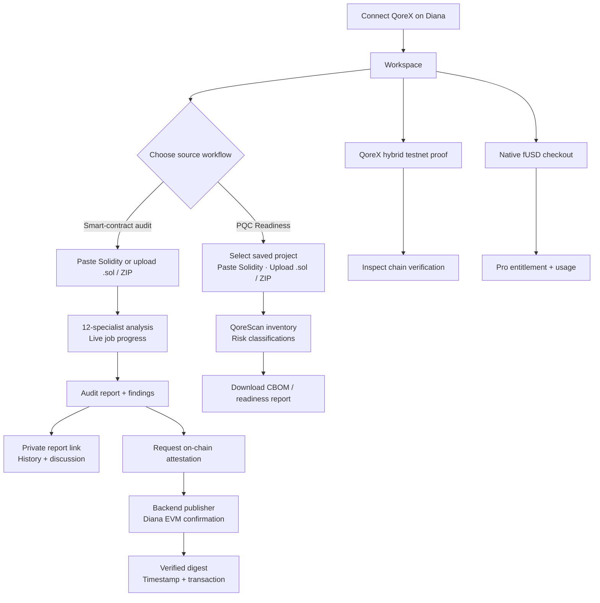

# QoreSentinel Workspace

**One workspace for smart-contract audits, post-quantum readiness, and on-chain security evidence.**

QoreSentinel takes users from a Solidity contract to a detailed security report, a cryptographic inventory, and QoreChain hybrid-signature evidence. The workspace brings together 12-specialist contract analysis, QoreScan-generated CBOMs, private audit history, UI-requested QoreChain audit attestations, and QoreX-powered testnet activity without splitting the process across separate tools.

Built with Next.js 15, React 19, and TypeScript, the workspace connects to a FastAPI backend that manages audit execution, wallet authentication, report access, and subscriptions.

**Public landing page:** https://qoresentinel.vercel.app  
**Existing workspace:** https://qoresentinel.vercel.app/overview  
**Network:** QoreChain Diana testnet (`qorechain-diana` / EVM chain ID `9800`)

## Public landing page and preserved workspace

The root route `/` now presents QoreSentinel's public product landing page. It introduces the 12-specialist auditing engine, QoreScan cryptographic inventory, verified Diana report-attestation evidence, and clear calls to action for `/new-audit` and `/overview`. Its interface preview is **illustrative** and is explicitly labeled as such; no fabricated customer numbers or audit results are shown.

**The existing Overview screen is unchanged** at `/overview`, and all other workspace routes including `/audits/{audit-id}` remain available with their existing wallet-authenticated behavior. The original workspace implementation now resides in `src/app/workspace-client.tsx`; known workspace routes load that component rather than the public root page. Landing styles live in `src/app/landing.css` and are scoped to `.lp-root` so workspace design remains intact.

## From wallet connection to security insight

The workspace provides continuous navigation between audit results, cryptographic readiness, chain verification, and billing, while project and report access remains tied to the connected wallet.

### Wallet connection

The entry flow detects the QoreX extension and requests its native `qor1` account on Diana. Authentication uses a one-time backend challenge and a user-approved native 1 uqor self-transfer carrying the challenge memo. The backend confirms the transfer and hybrid-verification evidence before the workspace is authenticated.

The interface accounts for wallet-locked states, rejected requests, insufficient testnet QOR and network mismatches. Wallet access requests can invoke QoreX's unlock prompt when supported by the installed extension. A one-hour HTTP-only session cookie allows a page refresh without an additional sign-in transfer while the session remains valid.

QoreX manages wallet secrets and transaction approvals inside its extension, while QoreSentinel uses verified wallet sessions to connect the workspace to its owner's projects and reports.

### New Audit → Progress → Results

The **New Audit** view accepts pasted Solidity, multiple `.sol` files, or a ZIP of Solidity sources. Each submission becomes a wallet-linked project and enters the twelve-specialist security analysis workflow. The progress page polls the persisted job and shows the completed-agent count from the twelve-specialist backend workflow.

When the final report is available, **Audit Results** renders the Markdown report, report-derived finding summaries and agent outputs. Reports bring together findings, severity indicators, source evidence, agent outputs, and the final analysis in a single results view.

**Audit History** lists saved jobs across the authenticated wallet. Each report has a permanent `/audits/{audit-id}` URL protected by backend wallet-ownership checks. The same audit's Q&A discussion is stored and can be reopened later. Pending audit jobs can also be revisited by their URL.

### Audit Results → On-chain attestation

After an audit completes, the **On-chain evidence → Audit report attestation** panel displays the report's SHA-256 digest, the deployed Diana contract address and the current publication status. The authenticated report owner can select **Request on-chain attestation**. The request uses the existing wallet session; **the user does not need to sign an attestation transaction in QoreX or provide their private key to the browser**.

The FastAPI backend verifies audit ownership and completion, records the request, and uses a dedicated testnet publisher to open a hybrid-authorized, contract-scoped EVM window and publish the digest. The UI checks the backend's request status and the contract's read-only verification result; it never signs or broadcasts the publisher's EVM transaction.

| State shown in the panel | Meaning |
| --- | --- |
| `Not attested yet` | No timestamp exists for this exact report digest in the configured Diana contract. |
| `queued` / `processing` | The wallet-owned request is accepted or being handled by the backend. |
| `submitted` | A signed EVM transaction hash was saved; on-chain confirmation is not yet established. |
| `confirmed` and `Verified on Diana` | The backend reconciled an EVM receipt and matching digest, and the contract reports a publication timestamp. |
| `failed` | The publisher could not complete the request. The UI shows a retry control **only when the backend marks a pre-broadcast attempt recoverable**; requests with uncertain transaction outcomes are not blindly resent. |

The panel's **Refresh** action retrieves the latest request and attestation status. While a request is pending, the UI also polls for changes. A completed audit can be reopened from **Audit History** or its `/audits/{audit-id}` URL to review the saved proof. The report itself remains access-controlled and is **not** placed on-chain.

**Verified UI demonstration (28 November 2026):**

- **Contract (Diana EVM, chain ID 9800):** `0x457962c68d6F3BeaAdAF47456402F57Fb40Fc6BF`
- **Published report SHA-256:** `0x5dad307f63853af2af9590c2ac3656895e1e64385603c60937264d11d653039f`
- **Confirmed UI-requested attestation tx:** `0x4ba2f6d45ce7afe5a0eef16c34f820d4528a29149890633860e38e79e9f2a958`
- **On-chain timestamp:** `2026-11-28 09:06:22 UTC`
- **Observed UI status:** `confirmed` / **Verified on Diana**

This is a testnet example of timestamping the **exact saved report bytes**; it does **not** certify that every AI-reported vulnerability is correct. The transaction is different from the separate native hybrid-window proof recorded in the [root README](../README.md#verified-live-attestation-28-november-2026).

For endpoint details, publisher security boundaries and retry limitations, consult [backend/README.md](../backend/README.md#automated-report-attestations-diana-only) and [onchain/README.md](../onchain/README.md#automated-publishing-and-verification).

### PQC Readiness

**PQC Readiness** is a separate, non-audit workflow. Its three input choices are:

| Input | Behavior |
| --- | --- |
| **Saved project** | Reuses Solidity source already owned by the connected wallet. |
| **Paste Solidity** | Runs QoreScan on the pasted source without creating a project. |
| **Upload files / ZIP** | Runs QoreScan on uploaded `.sol` sources without creating a project. |

A scan surfaces discovered cryptographic assets, file/line evidence, QoreScan classifications and a CycloneDX 1.6 CBOM. The workspace can also export QoreScan's framework-mapped Markdown readiness report. **PQC scanning runs on demand with no audit-credit cost or stored scan history.** Users can rerun source analysis whenever a contract changes and export their CBOMs and readiness reports.

The adjoining **QoreChain hybrid-signature evidence** panel is intentionally distinct from the Solidity scan. Users can approve a native testnet proof in QoreX, inspect its transaction hash, and see whether the chain reports a hybrid-verification event. This pairs cryptographic source visibility with transaction-level hybrid-signature evidence from Diana.

### Billing and Usage

**Billing & Usage** displays the active Free or Pro entitlement, a wallet-specific audit allowance and pending native fUSD payment intents. A Pro purchase uses the testnet quote returned by FastAPI, checks wallet balances and asks QoreX to approve the exact native transfer to the configured treasury.

The wallet's broadcast hash can be retained against an intent so an interrupted checkout can be resumed. The backend verifies the on-chain settlement before activating Pro. **Transaction History** distinguishes verified authentication, proof and subscription activity recorded for the wallet.

## Navigation

| Route | Screen |
| --- | --- |
| `/` | Public product landing page, no wallet required. |
| `/overview` | Existing workspace status and recent activity, preserved. |
| `/new-audit` | Solidity project submission and audit launch. |
| `/audit-progress` | Agent-completion progress for an active job. |
| `/audit-results` | The currently selected report, its discussion and on-chain report-attestation panel. |
| `/audit-history` | Wallet-scoped saved audits and report navigation. |
| `/audits/{audit-id}` | Permanent, owner-restricted audit report or live job view, including attestation status for completed audits. |
| `/ai-assistant` | Project-aware security questions using saved source. |
| `/pqc-readiness` | Stateless QoreScan, CBOM exports and hybrid chain proof. |
| `/transaction-history` | Verified wallet-linked QoreChain activity. |
| `/billing` | fUSD testnet checkout, subscriptions and usage. |
| `/settings` | Wallet identity, session status and service information. |

The sidebar uses browser-history-aware routes; back/forward navigation and direct audit URLs are supported.

## Frontend implementation

| Area | Implementation |
| --- | --- |
| **Application** | Next.js 15 App Router, React 19, TypeScript and Lucide icons. |
| **Public landing** | `src/app/page.tsx` is the server-rendered marketing page; `src/app/landing.css` contains isolated styling. |
| **Workspace screen** | `src/app/workspace-client.tsx` preserves session state, source submission, audit polling, report-attestation request/status UI, QoreScan display, payment recovery and wallet interactions. |
| **Navigation** | `src/lib/routes.ts` maps sections to URLs and parses audit identifiers. `src/app/[section]/` and `src/app/audits/[auditId]/` provide route entry points. |
| **API client** | `src/lib/api.ts` calls FastAPI through the `/backend-proxy` rewrite, manages the in-memory Bearer token and works with the HTTP-only session cookie; it also provides the authenticated report-attestation request and status endpoints. |
| **QoreX integration** | `src/lib/wallet.ts` requests native wallet access, constructs MsgSend transfers, classifies wallet errors and delegates signing/broadcast to QoreX. |
| **Design** | `src/app/globals.css` defines the workspace, report presentation, wallet onboarding and scanner views. |
| **Deployment** | Vercel hosts the frontend. `next.config.ts` forwards `/backend-proxy/:path*` to the configured `BACKEND_URL`, the Render FastAPI service in the hosted environment. |

The security boundary separates browser presentation from backend-controlled cloud-provider credentials, session signing, **attestation publisher credentials**, treasury configuration, wallet authorization, and on-chain settlement checks. Attestation signing is server-side; QoreX remains the user-facing native wallet. QoreX remains responsible for native signing.

## Connected security experience

QoreSentinel unifies **wallet authentication**, **twelve-specialist security analysis**, **source-based cryptographic inventory**, **user-requested on-chain audit attestation**, **chain-reported hybrid verification**, and **testnet subscription management** in one navigable workspace.

Every audit report and discussion is associated with its authenticated wallet. Protected report URLs open the saved analysis directly for the owner, and backend-issued sessions support continuity across browser refreshes.

The frontend surfaces Free and Pro usage with the backend's rolling 24-hour allowances, while PQC Readiness offers on-demand source analysis independently of audit-credit usage.

The backend implementation and persistence model are documented in [`backend/README.md`](../backend/README.md). The complete product narrative and license are in the [repository README](../README.md).
